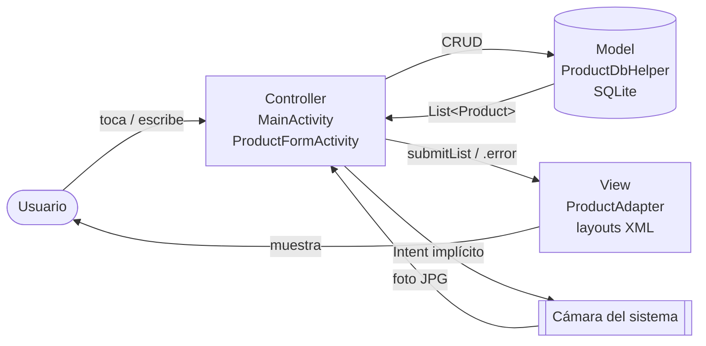
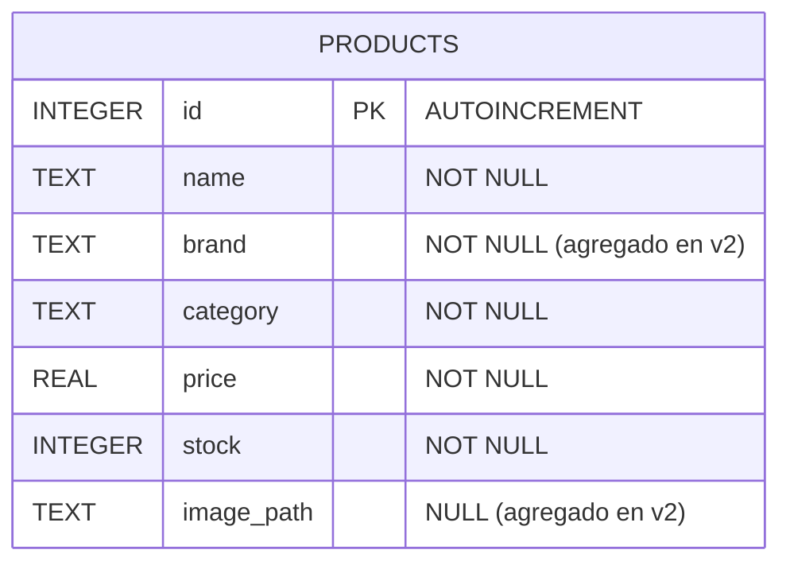
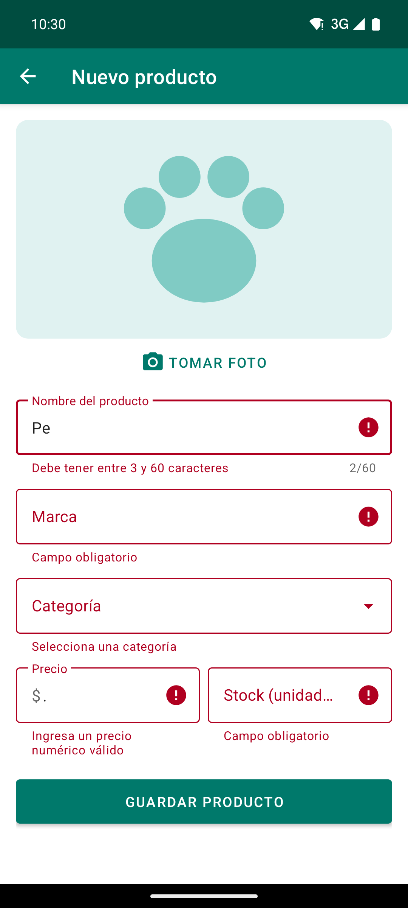
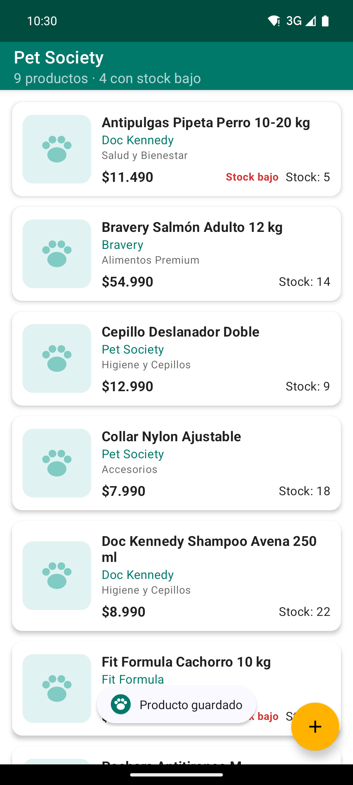
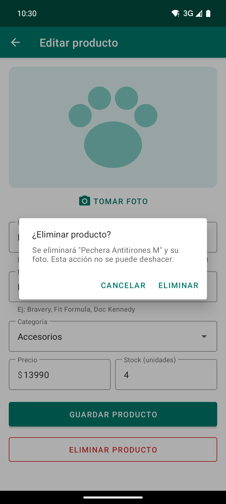

# Informe — Trabajo Sumativo Unidad 2

## Aplicación de Gestión de Inventario "Pet Society"

| | |
|---|---|
| **Asignatura** | Desarrollo de Aplicaciones Móviles |
| **Unidad** | Unidad 2 — Persistencia y CRUD con SQLite |
| **Estudiante** | _[Nombre y apellido]_ |
| **Docente** | _[Nombre del docente]_ |
| **Fecha** | _[dd-mm-aaaa]_ |

---

## Índice

1. [Introducción](#1-introducción)
2. [Desarrollo](#2-desarrollo)
   - 2.1 [Descripción general y arquitectura MVC](#21-descripción-general-y-arquitectura-mvc)
   - 2.2 [Diagrama de la base de datos](#22-diagrama-de-la-base-de-datos)
   - 2.3 [Evidencias del código: Model](#23-evidencias-del-código-model)
   - 2.4 [Evidencias del código: Helper (SQLiteOpenHelper)](#24-evidencias-del-código-helper-sqliteopenhelper)
   - 2.5 [Evidencias del código: Context](#25-evidencias-del-código-context)
   - 2.6 [Evidencias del código: Activities](#26-evidencias-del-código-activities)
   - 2.7 [Evidencias del código: RecyclerView y ViewHolder](#27-evidencias-del-código-recyclerview-y-viewholder)
   - 2.8 [Servicio del sistema: cámara](#28-servicio-del-sistema-cámara)
3. [Evidencias de ejecución](#3-evidencias-de-ejecución)
4. [Conclusión](#4-conclusión)
5. [Referencias bibliográficas](#5-referencias-bibliográficas)

---

## 1. Introducción

Una tienda que vende alimentos, snacks, artículos de higiene, juguetes y accesorios para mascotas maneja a diario decenas de productos que cambian de precio y de stock. Si ese control se lleva en una libreta o en la memoria del vendedor, es fácil vender algo que ya no queda, olvidar reponer un alimento de alta rotación o perder el registro de lo que se tiene en bodega. Este trabajo nace de ese problema concreto: construir **Pet Society**, una aplicación Android de gestión de inventario que permita registrar cada producto con su nombre, marca, categoría, precio y stock, acompañarlo de una fotografía como evidencia visual y conservar toda la información en el propio dispositivo aunque la aplicación se cierre o el teléfono se reinicie.

Para lograrlo apliqué los contenidos de la Unidad 2. La persistencia se resolvió con una base de datos SQLite administrada por una clase que hereda de `SQLiteOpenHelper`, con las cuatro operaciones del CRUD y un método `onUpgrade` que actualiza el esquema sin borrar los datos existentes. El listado de productos se muestra con un `RecyclerView` que usa el patrón ViewHolder, de modo que la lista se mantiene fluida aunque crezca. Antes de guardar, cada dato ingresado pasa por una validación defensiva basada en `.trim()`, `.isEmpty()` y `.toDoubleOrNull()`, y los errores se informan en el mismo campo mediante la propiedad `.error`, sin ventanas que interrumpan al usuario. Finalmente, la fotografía se obtiene a través de la cámara del sistema mediante un intent implícito.

El código se organizó siguiendo el modelo **MVC** (Modelo-Vista-Controlador), tomando como base el laboratorio de la unidad. En las secciones siguientes presento el diagrama de la base de datos, los fragmentos más relevantes del código fuente y las capturas que demuestran el funcionamiento de la aplicación.

---

## 2. Desarrollo

### 2.1 Descripción general y arquitectura MVC

La aplicación tiene dos pantallas:

- **Listado de inventario** (`MainActivity`): muestra todos los productos con su foto, nombre, marca, categoría, precio (en pesos chilenos) y stock. Marca con la etiqueta *"Stock bajo"* los productos con 5 unidades o menos, y la barra superior resume el total, por ejemplo *"8 productos · 2 con stock bajo"*.
- **Formulario** (`ProductFormActivity`): permite crear un producto nuevo o editar y eliminar uno existente. Incluye el botón para tomar la fotografía.

**Tecnologías:** Kotlin, vistas XML con ViewBinding, Material Components, SQLite (`SQLiteOpenHelper`), `RecyclerView` y Glide para cargar las imágenes. Compila para `minSdk 24` y `targetSdk 34`.

El código se dividió en tres paquetes, uno por cada capa del modelo MVC:

```
com.petsociety.inventario
├── model/                     ← MODELO: datos y acceso a la base de datos
│   ├── Product.kt             (clase de datos + categorías + regla de stock bajo)
│   └── ProductDbHelper.kt     (SQLiteOpenHelper: esquema, CRUD y migraciones)
├── view/                      ← VISTA: presentación de los datos
│   └── ProductAdapter.kt      (adaptador del RecyclerView con ViewHolder)
└── controller/                ← CONTROLADOR: lógica de cada pantalla
    ├── MainActivity.kt        (listado)
    └── ProductFormActivity.kt (alta, edición, borrado, validación y cámara)

res/layout/                    ← VISTA (XML)
├── activity_main.xml
├── activity_product_form.xml
└── item_product.xml           (diseño de cada fila de la lista)
```

Las capas se comunican en un solo sentido. El **controlador** pide los datos al **modelo** (`ProductDbHelper`) y se los entrega a la **vista** (`ProductAdapter` y los layouts XML). La vista no accede nunca a la base de datos, y el modelo no conoce las pantallas.



### 2.2 Diagrama de la base de datos

La base de datos se llama **`PetSocietyDB`** y está en su **versión 2**. Tiene una sola tabla, `products`:



| Columna | Tipo SQLite | Restricción | Descripción | Versión |
|---|---|---|---|---|
| `id` | INTEGER | PRIMARY KEY AUTOINCREMENT | Identificador único del producto | v1 |
| `name` | TEXT | NOT NULL | Nombre comercial (3 a 60 caracteres) | v1 |
| `brand` | TEXT | NOT NULL DEFAULT '' | Marca (Bravery, Fit Formula, Doc Kennedy…) | **v2** |
| `category` | TEXT | NOT NULL | Una de las 6 categorías de la tienda | v1 |
| `price` | REAL | NOT NULL | Precio en CLP (mayor que 0) | v1 |
| `stock` | INTEGER | NOT NULL | Unidades disponibles (0 a 99.999) | v1 |
| `image_path` | TEXT | admite NULL | Ruta de la foto en el almacenamiento interno | **v2** |

**Evolución del esquema:**

```
v1: products(id, name, category, price, stock)
        │
        │  onUpgrade (oldVersion < 2)
        │  ALTER TABLE products ADD COLUMN brand TEXT NOT NULL DEFAULT ''
        │  ALTER TABLE products ADD COLUMN image_path TEXT
        ▼
v2: products(id, name, brand, category, price, stock, image_path)
```

La primera versión de la tabla tenía solo los cuatro datos que pide el enunciado. Al agregar la marca y la foto, subí la versión a 2 y escribí una migración incremental que añade solo las columnas nuevas, para que un usuario que ya tenía productos guardados no los pierda al actualizar la app.

Las fotos **no** se guardan dentro de la base de datos, porque un BLOB grande vuelve lentas las consultas. Se guardan como archivos JPG en la carpeta privada `filesDir/images/`, y la tabla almacena solo su ruta en `image_path`.

### 2.3 Evidencias del código: Model

`Product` es una `data class` de Kotlin que representa una fila de la tabla. Además de los datos, contiene la regla de negocio de "stock bajo" y la lista fija de categorías, que comparten el formulario y la validación.

**Archivo:** `model/Product.kt`

```kotlin
data class Product(
    val id: Long = 0,                 // 0 = todavía no existe en la BD
    val name: String,
    val brand: String,
    val category: String,
    val price: Double,
    val stock: Int,
    val imagePath: String? = null
) {
    val isLowStock: Boolean
        get() = stock <= LOW_STOCK_LIMIT

    companion object {
        const val LOW_STOCK_LIMIT = 5

        val CATEGORIES = listOf(
            "Alimentos Premium", "Snacks", "Salud y Bienestar",
            "Higiene y Cepillos", "Juguetes", "Accesorios"
        )
    }
}
```

Usar `data class` permite comparar dos productos por su contenido (`==`). El adaptador aprovecha esto para saber qué filas cambiaron.

### 2.4 Evidencias del código: Helper (SQLiteOpenHelper)

`ProductDbHelper` hereda de `SQLiteOpenHelper` e implementa los dos métodos obligatorios, `onCreate` y `onUpgrade`, además de las cuatro operaciones del CRUD.

**Archivo:** `model/ProductDbHelper.kt`

**Constantes y creación de la tabla (`onCreate`):**

```kotlin
class ProductDbHelper(context: Context) :
    SQLiteOpenHelper(context.applicationContext, DATABASE_NAME, null, DATABASE_VERSION) {

    companion object {
        private const val DATABASE_NAME = "PetSocietyDB"
        private const val DATABASE_VERSION = 2
        private const val TABLE_PRODUCTS = "products"
        private const val KEY_ID = "id"
        private const val KEY_NAME = "name"
        private const val KEY_BRAND = "brand"
        private const val KEY_CATEGORY = "category"
        private const val KEY_PRICE = "price"
        private const val KEY_STOCK = "stock"
        private const val KEY_IMAGE_PATH = "image_path"
    }

    override fun onCreate(db: SQLiteDatabase) {
        val createTable = ("CREATE TABLE $TABLE_PRODUCTS ("
                + "$KEY_ID INTEGER PRIMARY KEY AUTOINCREMENT,"
                + "$KEY_NAME TEXT NOT NULL,"
                + "$KEY_BRAND TEXT NOT NULL,"
                + "$KEY_CATEGORY TEXT NOT NULL,"
                + "$KEY_PRICE REAL NOT NULL,"
                + "$KEY_STOCK INTEGER NOT NULL,"
                + "$KEY_IMAGE_PATH TEXT" + ")")
        db.execSQL(createTable)
    }
```

**Migración del esquema (`onUpgrade`):**

En el laboratorio, `onUpgrade` ejecuta `DROP TABLE` y vuelve a crear la tabla, lo que borra todo el inventario del usuario al actualizar la app. Lo reemplacé por una migración incremental: cada bloque `if (oldVersion < N)` lleva la base de datos de una versión a la siguiente usando `ALTER TABLE`, así que los productos existentes se conservan.

```kotlin
    override fun onUpgrade(db: SQLiteDatabase, oldVersion: Int, newVersion: Int) {
        if (oldVersion < 2) {
            // v1 -> v2: se agregan marca y ruta de la foto sin perder datos
            addColumnIfMissing(db, KEY_BRAND, "TEXT NOT NULL DEFAULT ''")
            addColumnIfMissing(db, KEY_IMAGE_PATH, "TEXT")
        }
        // if (oldVersion < 3) { ... próxima migración ... }
    }

    /** Evita el error "duplicate column" si la columna ya existe. */
    private fun addColumnIfMissing(db: SQLiteDatabase, column: String, definition: String) {
        val exists = db.rawQuery("PRAGMA table_info($TABLE_PRODUCTS)", null).use { cursor ->
            val nameIndex = cursor.getColumnIndexOrThrow("name")
            generateSequence { if (cursor.moveToNext()) cursor.getString(nameIndex) else null }
                .any { it == column }
        }
        if (!exists) {
            db.execSQL("ALTER TABLE $TABLE_PRODUCTS ADD COLUMN $column $definition")
        }
    }
```

**Operaciones CRUD:**

```kotlin
    /** CREATE: devuelve el id generado, o -1 si falló. */
    fun insertProduct(product: Product): Long =
        writableDatabase.insert(TABLE_PRODUCTS, null, toContentValues(product))

    /** READ: todos los productos ordenados alfabéticamente. */
    fun getAllProducts(): List<Product> {
        val products = mutableListOf<Product>()
        readableDatabase.query(
            TABLE_PRODUCTS, null, null, null, null, null,
            "$KEY_NAME COLLATE NOCASE ASC"
        ).use { cursor ->
            while (cursor.moveToNext()) {
                products.add(cursorToProduct(cursor))
            }
        }
        return products
    }

    /** READ: un producto por su id, o null si no existe. */
    fun getProductById(id: Long): Product? {
        readableDatabase.query(
            TABLE_PRODUCTS, null, "$KEY_ID = ?", arrayOf(id.toString()),
            null, null, null
        ).use { cursor ->
            return if (cursor.moveToFirst()) cursorToProduct(cursor) else null
        }
    }

    /** UPDATE: devuelve la cantidad de filas modificadas. */
    fun updateProduct(product: Product): Int =
        writableDatabase.update(
            TABLE_PRODUCTS, toContentValues(product),
            "$KEY_ID = ?", arrayOf(product.id.toString())
        )

    /** DELETE: devuelve la cantidad de filas eliminadas. */
    fun deleteProduct(id: Long): Int =
        writableDatabase.delete(TABLE_PRODUCTS, "$KEY_ID = ?", arrayOf(id.toString()))
```

Decisiones de diseño en el Helper:

- **Consultas parametrizadas (`"id = ?"` + `arrayOf(...)`):** el valor nunca se concatena al SQL, lo que previene la inyección SQL.
- **`.use { cursor -> ... }`:** cierra el `Cursor` automáticamente, incluso si ocurre una excepción, y evita fugas de memoria.
- **`ContentValues`:** se arma en un único método (`toContentValues`) que comparten el `insert` y el `update`, para no repetir código.
- La conexión no se cierra después de cada operación, como en el laboratorio, sino una sola vez en `onDestroy()` de cada Activity, porque abrir y cerrar la base en cada consulta tiene un costo innecesario.

### 2.5 Evidencias del código: Context

El `Context` es el objeto que da acceso a los recursos y servicios de Android. En la aplicación se usa en cuatro puntos:

**1. Crear la base de datos.** `SQLiteOpenHelper` necesita un `Context` para saber dónde está la carpeta privada de la app (`/data/data/com.petsociety.inventario/databases/`). Le paso `context.applicationContext`, que vive mientras vive la aplicación. Así el Helper no retiene la Activity y no hay fuga de memoria si esta se destruye, por ejemplo al rotar la pantalla.

```kotlin
class ProductDbHelper(context: Context) :
    SQLiteOpenHelper(context.applicationContext, DATABASE_NAME, null, DATABASE_VERSION)

// En cada Activity (la Activity es un Context):
dbHelper = ProductDbHelper(this)
```

**2. Acceder a los recursos (textos y plurales).** Todos los mensajes salen de `strings.xml` mediante el Context, no van escritos en el código:

```kotlin
binding.tilName.error = getString(R.string.error_required)
val count = resources.getQuantityString(R.plurals.products_count, products.size, products.size)
```

**3. Usar el almacenamiento interno y el FileProvider para las fotos:**

```kotlin
val dir = File(filesDir, "images").apply { mkdirs() }                 // filesDir viene del Context
val photoUri = FileProvider.getUriForFile(this, "$packageName.fileprovider", photoFile)
```

**4. Obtener el Context dentro del ViewHolder**, que no es una Activity, a partir de su propia vista:

```kotlin
val context = binding.root.context
binding.tvProductStock.text = context.getString(R.string.stock_value, product.stock)
```

### 2.6 Evidencias del código: Activities

#### `MainActivity` — Controlador del listado

Configura el `RecyclerView`, abre el formulario con un **intent explícito** y recarga la lista en `onResume()`, de modo que al volver del formulario se reflejen los cambios.

**Archivo:** `controller/MainActivity.kt`

```kotlin
class MainActivity : AppCompatActivity() {

    private lateinit var binding: ActivityMainBinding
    private lateinit var dbHelper: ProductDbHelper
    private lateinit var adapter: ProductAdapter

    override fun onCreate(savedInstanceState: Bundle?) {
        super.onCreate(savedInstanceState)
        binding = ActivityMainBinding.inflate(layoutInflater)
        setContentView(binding.root)

        dbHelper = ProductDbHelper(this)
        setupRecyclerView()

        // Intent explícito: abrir el formulario vacío (nuevo producto)
        binding.fabAdd.setOnClickListener {
            startActivity(Intent(this, ProductFormActivity::class.java))
        }
    }

    override fun onResume() {
        super.onResume()
        refreshList()          // se recarga al volver del formulario
    }

    override fun onDestroy() {
        dbHelper.close()
        super.onDestroy()
    }

    private fun setupRecyclerView() {
        adapter = ProductAdapter { product ->
            // Intent explícito con datos: se envía solo el id del producto
            val intent = Intent(this, ProductFormActivity::class.java)
            intent.putExtra(ProductFormActivity.EXTRA_PRODUCT_ID, product.id)
            startActivity(intent)
        }
        binding.rvProducts.layoutManager = LinearLayoutManager(this)
        binding.rvProducts.setHasFixedSize(true)
        binding.rvProducts.adapter = adapter
    }

    private fun refreshList() {
        val products = dbHelper.getAllProducts()      // READ desde el modelo
        adapter.submitList(products)                  // entrega a la vista
        val isEmpty = products.isEmpty()
        binding.layoutEmpty.visibility = if (isEmpty) View.VISIBLE else View.GONE
        binding.rvProducts.visibility = if (isEmpty) View.GONE else View.VISIBLE
        // ... subtítulo con el total y los productos con stock bajo
    }
}
```

En lugar de enviar el objeto `Product` completo con `Serializable`, como en el laboratorio, envío solo el `id`, y el formulario vuelve a leer el producto desde la base de datos. Así el formulario siempre trabaja con datos actualizados, y se evita `getSerializableExtra`, que está obsoleto (*deprecated*).

#### `ProductFormActivity` — Controlador del formulario

**Archivo:** `controller/ProductFormActivity.kt`

**Carga en modo edición y botón de retroceso (*Up Button*):**

```kotlin
override fun onCreate(savedInstanceState: Bundle?) {
    super.onCreate(savedInstanceState)
    binding = ActivityProductFormBinding.inflate(layoutInflater)
    setContentView(binding.root)
    supportActionBar?.setDisplayHomeAsUpEnabled(true)      // Up Button

    dbHelper = ProductDbHelper(this)

    val productId = intent.getLongExtra(EXTRA_PRODUCT_ID, 0L)
    if (productId > 0) {
        existingProduct = dbHelper.getProductById(productId)
        // ...
    }
    existingProduct?.let { product ->
        title = getString(R.string.title_edit_product)
        binding.btnDelete.visibility = View.VISIBLE
        if (savedInstanceState == null) fillForm(product)
    } ?: run {
        title = getString(R.string.title_new_product)
    }

    binding.btnTakePhoto.setOnClickListener { takePhoto() }
    binding.btnSave.setOnClickListener { saveProduct() }
    binding.btnDelete.setOnClickListener { confirmDelete() }
}
```

**Validación defensiva de datos.** Este es el algoritmo que pide el enunciado. Cada campo tiene su propia función de validación, que sigue cuatro pasos: (1) sanitizar con `.trim()`, (2) detectar campos vacíos con `.isEmpty()`, (3) convertir los números con `.toDoubleOrNull()` y `.toIntOrNull()`, que devuelven `null` en vez de lanzar una excepción, y (4) comprobar los rangos lógicos. La función devuelve el mensaje de error, o `null` si el dato es válido.

```kotlin
private fun nameError(): String? {
    val name = binding.etName.text.toString().trim()                 // 1. sanitizar
    return when {
        name.isEmpty() -> getString(R.string.error_required)         // 2. vacío
        name.length !in NAME_MIN..NAME_MAX ->                        // 4. rango
            getString(R.string.error_name_length, NAME_MIN, NAME_MAX)
        else -> null
    }
}

private fun categoryError(): String? {
    val category = binding.actvCategory.text.toString().trim()
    return when {
        category.isEmpty() -> getString(R.string.error_category_required)
        category !in Product.CATEGORIES -> getString(R.string.error_category_invalid)
        else -> null
    }
}

private fun priceError(): String? {
    val priceText = binding.etPrice.text.toString().trim().replace(',', '.')
    val price = priceText.toDoubleOrNull()                           // 3. conversión segura
    return when {
        priceText.isEmpty() -> getString(R.string.error_required)
        price == null -> getString(R.string.error_price_format)      // "." -> sin crash
        price <= 0 || price > PRICE_MAX -> getString(R.string.error_price_range)
        else -> null
    }
}

private fun stockError(): String? {
    val stockText = binding.etStock.text.toString().trim()
    val stock = stockText.toIntOrNull()
    return when {
        stockText.isEmpty() -> getString(R.string.error_required)
        stock == null -> getString(R.string.error_stock_format)
        stock !in 0..STOCK_MAX -> getString(R.string.error_stock_range, STOCK_MAX)
        else -> null
    }
}
// (brandError() sigue el mismo patrón que nameError())
```

Cada campo del formulario se asocia con su función de validación, para usar las mismas reglas al guardar y al escribir:

```kotlin
private fun fieldValidators(): List<Pair<TextInputLayout, () -> String?>> = listOf(
    binding.tilName to ::nameError,
    binding.tilBrand to ::brandError,
    binding.tilCategory to ::categoryError,
    binding.tilPrice to ::priceError,
    binding.tilStock to ::stockError
)
```

**Feedback visual inmediato con `.error` (validación en vivo).** El error no espera a que el usuario pulse "Guardar". Al salir de un campo, este se valida y, si el dato es incorrecto, el mensaje aparece en rojo con la propiedad **`.error`**. Desde ese momento, el campo se vuelve a validar con cada tecla: el mensaje aparece en cuanto el dato deja de ser válido (por ejemplo, al escribir una letra en el precio) y desaparece en cuanto se corrige. Un campo que el usuario todavía no ha visitado nunca se marca en rojo, así que la retroalimentación es inmediata pero **no intrusiva**: no hay ventanas emergentes ni se bloquea la escritura.

```kotlin
/** Campos que el usuario ya visitó: solo estos se validan mientras escribe. */
private val touchedFields = mutableSetOf<TextInputLayout>()

private fun setupLiveValidation() {
    fieldValidators().forEach { (layout, validate) ->
        val editText = layout.editText ?: return@forEach
        // Al salir del campo: se valida y se muestra el error
        editText.setOnFocusChangeListener { _, hasFocus ->
            if (!hasFocus) {
                touchedFields.add(layout)
                layout.error = validate()
            }
        }
        // Mientras escribe: el error aparece o desaparece con cada tecla
        editText.doAfterTextChanged {
            if (layout in touchedFields) layout.error = validate()
        }
    }
}
```

Como primera barrera, los campos de precio y stock usan un teclado numérico (`android:inputType="numberDecimal"` y `"number"`), que impide escribir letras. Aun así, hay entradas que el teclado deja pasar y que no son números, como un punto solo ("."), o texto pegado desde el portapapeles. Por eso la conversión segura con `.toDoubleOrNull()` sigue siendo necesaria.

**Validación al guardar.** Al pulsar "Guardar producto" se revisan **todos** los campos en una sola pasada, para que el usuario vea todos los problemas a la vez, incluidos los campos que dejó sin tocar. El foco salta al primer campo con error. A diferencia del laboratorio, que se detiene en el primer error, aquí no se pierde ningún mensaje.

```kotlin
private fun validateInput(): Product? {
    var isValid = true
    fieldValidators().forEach { (layout, validate) ->
        touchedFields.add(layout)          // desde ahora también se valida en vivo
        layout.error = validate()          // feedback visual con .error
        if (layout.error != null) isValid = false
    }

    val price = priceInput().toDoubleOrNull()
    val stock = binding.etStock.text.toString().trim().toIntOrNull()
    if (!isValid || price == null || stock == null) {
        focusFirstError()
        return null                        // no se guarda nada
    }

    return Product(
        name = binding.etName.text.toString().trim(),
        brand = binding.etBrand.text.toString().trim(),
        category = binding.actvCategory.text.toString().trim(),
        price = price,
        stock = stock
    )
}
```

**Guardado (CREATE / UPDATE) y confirmación con Toast:**

```kotlin
private fun saveProduct() {
    val validated = validateInput() ?: return        // si hay errores, no se guarda

    val oldProduct = existingProduct
    val product = validated.copy(
        id = oldProduct?.id ?: 0L,
        imagePath = pendingPhotoPath ?: oldProduct?.imagePath
    )

    val success = if (oldProduct == null) {
        dbHelper.insertProduct(product) != -1L        // CREATE
    } else {
        dbHelper.updateProduct(product) > 0           // UPDATE
    }

    if (success) {
        Toast.makeText(this, R.string.msg_saved, Toast.LENGTH_SHORT).show()  // "Producto guardado"
        finish()
    } else {
        Toast.makeText(this, R.string.msg_save_error, Toast.LENGTH_SHORT).show()
    }
}
```

**Borrado (DELETE) con confirmación previa:**

```kotlin
private fun confirmDelete() {
    val product = existingProduct ?: return
    MaterialAlertDialogBuilder(this)
        .setTitle(R.string.dialog_delete_title)
        .setMessage(getString(R.string.dialog_delete_message, product.name))
        .setNegativeButton(R.string.btn_cancel, null)
        .setPositiveButton(R.string.btn_delete) { _, _ -> deleteProduct(product) }
        .show()
}

private fun deleteProduct(product: Product) {
    if (dbHelper.deleteProduct(product.id) > 0) {     // DELETE
        deleteFileIfExists(product.imagePath)         // también se borra la foto
        Toast.makeText(this, R.string.msg_deleted, Toast.LENGTH_SHORT).show()
        finish()
    }
}
```

**Declaración de las Activities en el Manifest.** El formulario declara a `MainActivity` como su padre, para que funcione el *Up Button*:

```xml
<activity
    android:name=".controller.MainActivity"
    android:exported="true">
    <intent-filter>
        <action android:name="android.intent.action.MAIN" />
        <category android:name="android.intent.category.LAUNCHER" />
    </intent-filter>
</activity>

<activity
    android:name=".controller.ProductFormActivity"
    android:exported="false"
    android:parentActivityName=".controller.MainActivity" />
```

### 2.7 Evidencias del código: RecyclerView y ViewHolder

**Archivo:** `view/ProductAdapter.kt`

El adaptador hereda de `ListAdapter`, una subclase de `RecyclerView.Adapter`, e implementa el patrón **ViewHolder**. Cada fila se infla una sola vez en `onCreateViewHolder`. Cuando sale de la pantalla, se recicla y `onBindViewHolder` solo le cambia los datos. Gracias a **ViewBinding**, el ViewHolder guarda las referencias a los controles y no hay que llamar a `findViewById` en cada desplazamiento.

```kotlin
class ProductAdapter(
    private val onItemClick: (Product) -> Unit
) : ListAdapter<Product, ProductAdapter.ProductViewHolder>(DIFF_CALLBACK) {

    class ProductViewHolder(
        private val binding: ItemProductBinding,          // referencias guardadas
        private val onItemClick: (Product) -> Unit
    ) : RecyclerView.ViewHolder(binding.root) {

        private var currentProduct: Product? = null

        init {
            // El listener se crea una vez por ViewHolder, no en cada bind
            binding.root.setOnClickListener { currentProduct?.let(onItemClick) }
        }

        fun bind(product: Product) {
            currentProduct = product
            binding.tvProductName.text = product.name
            binding.tvProductBrand.text = product.brand
            binding.tvProductCategory.text = product.category
            binding.tvProductPrice.text = formatPrice(product.price)       // $54.990
            binding.tvProductStock.text =
                binding.root.context.getString(R.string.stock_value, product.stock)
            binding.tvLowStock.visibility = if (product.isLowStock) View.VISIBLE else View.GONE

            // Glide decodifica la foto en segundo plano (sin bloquear el hilo principal)
            Glide.with(binding.ivProductPhoto)
                .load(product.imagePath?.let { File(it) })
                .placeholder(R.drawable.ic_pet_placeholder)
                .centerCrop()
                .into(binding.ivProductPhoto)
        }
    }

    override fun onCreateViewHolder(parent: ViewGroup, viewType: Int): ProductViewHolder {
        val binding = ItemProductBinding.inflate(LayoutInflater.from(parent.context), parent, false)
        return ProductViewHolder(binding, onItemClick)
    }

    override fun onBindViewHolder(holder: ProductViewHolder, position: Int) {
        holder.bind(getItem(position))
    }
}
```

Tres medidas aseguran la fluidez (*jank-free*):

1. **ViewHolder:** las vistas se reciclan y no se buscan de nuevo.
2. **`DiffUtil`:** al recargar la lista, solo se redibujan las filas que cambiaron, y no la lista completa como ocurriría con `notifyDataSetChanged()`.

```kotlin
private val DIFF_CALLBACK = object : DiffUtil.ItemCallback<Product>() {
    override fun areItemsTheSame(oldItem: Product, newItem: Product) = oldItem.id == newItem.id
    override fun areContentsTheSame(oldItem: Product, newItem: Product) = oldItem == newItem
}
```

3. **Glide:** decodificar una foto de la cámara (varios megapíxeles) en el hilo principal congelaría el desplazamiento. Glide la reduce al tamaño de la miniatura en segundo plano y la deja en caché.

### 2.8 Servicio del sistema: cámara

La "evidencia visual" de cada producto se captura con la cámara del sistema mediante un **intent implícito**: la app pide "tomar una foto" y Android abre la aplicación de cámara instalada.

El laboratorio usa `startActivityForResult` con `ACTION_IMAGE_CAPTURE` y obtiene solo una miniatura (`data.extras.get("data")`). En este proyecto usé la versión actual de la misma idea, `ActivityResultContracts.TakePicture()`, que internamente lanza `ACTION_IMAGE_CAPTURE` y guarda la foto **en resolución completa** en el archivo que le entrega la app. El acceso al archivo se concede de forma temporal y segura mediante un `FileProvider`.

```kotlin
// Registro del contrato: la cámara escribe la foto en el archivo entregado
private val takePicture =
    registerForActivityResult(ActivityResultContracts.TakePicture()) { success ->
        val photoPath = tempPhotoPath ?: return@registerForActivityResult
        tempPhotoPath = null
        if (success) {
            pendingPhotoPath = photoPath
            showPhoto(photoPath)
        } else {
            deleteFileIfExists(photoPath)      // el usuario canceló
        }
    }

private fun takePhoto() {
    val photoFile = createImageFile()
    tempPhotoPath = photoFile.absolutePath
    val photoUri = FileProvider.getUriForFile(this, "$packageName.fileprovider", photoFile)
    try {
        takePicture.launch(photoUri)
    } catch (e: ActivityNotFoundException) {
        // No hay app de cámara: se informa en vez de cerrar la app
        Toast.makeText(this, R.string.msg_no_camera, Toast.LENGTH_SHORT).show()
    }
}
```

En el Manifest, la cámara se declara como **opcional** (`required="false"`), para que la app se pueda instalar también en dispositivos sin cámara. El `FileProvider` expone únicamente la carpeta `images/`:

```xml
<uses-feature android:name="android.hardware.camera.any" android:required="false" />

<provider
    android:name="androidx.core.content.FileProvider"
    android:authorities="${applicationId}.fileprovider"
    android:exported="false"
    android:grantUriPermissions="true">
    <meta-data
        android:name="android.support.FILE_PROVIDER_PATHS"
        android:resource="@xml/file_paths" />
</provider>
```

---

## 3. Evidencias de ejecución

Las capturas se tomaron con la aplicación ejecutándose en un emulador Android (API 35, pantalla de 1080 × 2400).

> Las imágenes están en la carpeta `capturas/`. En el `.docx`, insertarlas en este mismo orden.

### 3.1 Lista con datos


*Figura 1. Pantalla principal con el inventario cargado desde SQLite (8 productos de ejemplo). Cada fila muestra la foto, el nombre, la marca, la categoría, el precio en CLP y el stock. Los productos con 5 unidades o menos llevan la etiqueta "Stock bajo", y el subtítulo resume el total del inventario.*

### 3.2 Formulario rechazando datos erróneos (mensajes rojos)



*Figura 2. Al pulsar "Guardar producto" con datos erróneos, cada campo inválido muestra su mensaje en rojo mediante la propiedad `.error`: un nombre demasiado corto ("Pe") muestra "Debe tener entre 3 y 60 caracteres"; la marca y el stock vacíos muestran "Campo obligatorio"; la categoría, "Selecciona una categoría"; y un precio que no es un número (".") muestra "Ingresa un precio numérico válido". La aplicación no se cierra, porque la conversión se hace con `.toDoubleOrNull()`. Los mismos mensajes aparecen al salir de cada campo, sin necesidad de pulsar el botón, y desaparecen en cuanto el dato se corrige.*

### 3.3 Confirmación de guardado exitoso



*Figura 3. Tras corregir los datos (Pechera Antitirones M, marca Pet Society, categoría Accesorios, $13.990, 4 unidades), aparece el mensaje "Producto guardado" (Toast), la app vuelve automáticamente al listado y el subtítulo se actualiza de "8 productos · 3 con stock bajo" a "9 productos · 4 con stock bajo".*

### 3.4 Evidencias adicionales



*Figura 4. Cuadro de diálogo que pide confirmación antes de eliminar un producto (DELETE).*


*Figura 5. Lista después de cerrar la aplicación por completo (forzar detención) y volver a abrirla: los 9 productos siguen ahí, porque están guardados en SQLite.*

---

## 4. Conclusión

El desarrollo de Pet Society me permitió comprobar en la práctica que una aplicación útil no se mide solo por cómo se ve, sino por cómo trata los datos de quien la usa. El aprendizaje más importante fue el manejo de la persistencia con `SQLiteOpenHelper`. Implementar el CRUD fue relativamente directo, pero al agregar la marca y la fotografía me encontré con el problema de qué pasa con los productos que el usuario ya tenía guardados. Si hubiese mantenido el `DROP TABLE` en `onUpgrade`, cada actualización de la app habría borrado el inventario completo. Escribir una migración incremental con `ALTER TABLE` me hizo entender que la versión de la base de datos es un compromiso con el usuario, y que cada cambio en el esquema debe planificarse.

También aprendí a valorar la validación defensiva. Una sola llamada a `toDouble()` sobre un texto como "abc" basta para cerrar la aplicación. Usar `.trim()`, `.isEmpty()` y `.toDoubleOrNull()`, y mostrar los errores con `.error` junto a cada campo, convierte un posible crash en un mensaje claro que guía al usuario sin interrumpirlo. Con el `RecyclerView` entendí por qué el patrón ViewHolder es obligatorio: reutilizar las vistas, actualizar solo las filas que cambian con `DiffUtil` y cargar las imágenes en segundo plano son decisiones que mantienen la lista fluida aunque el inventario crezca.

Organizar el proyecto con MVC hizo que cada cambio tuviera un lugar claro: agregar una categoría solo requiere tocar el modelo, y cambiar un mensaje solo requiere tocar los recursos. Como mejoras futuras, la aplicación podría incorporar búsqueda y filtros por categoría, un historial de movimientos de stock y la migración a Room, que la documentación oficial de Android recomienda como capa sobre SQLite. La base construida en este trabajo hace posible esa evolución sin perder los datos ya registrados.

---

## 5. Referencias bibliográficas

Android Developers. (2026a). *Create dynamic lists with RecyclerView*. https://developer.android.com/develop/ui/views/layout/recyclerview

Android Developers. (2026b). *Intents and intent filters*. https://developer.android.com/guide/components/intents-filters

Android Developers. (2026c). *Save data using SQLite*. https://developer.android.com/training/data-storage/sqlite

Android Developers. (2026d). *Save data in a local database using Room*. https://developer.android.com/training/data-storage/room

Android Developers. (2026e). *Take photos*. https://developer.android.com/media/camera/camera-deprecated/photobasics

Android Developers. (2026f). *FileProvider*. https://developer.android.com/reference/androidx/core/content/FileProvider

Donoso, J. P. (2026). *Unidad 2: Persistencia y CRUD con SQLite* [Material de clase]. Desarrollo de Aplicaciones Móviles, Universidad Mayor.

SQLite. (s.f.). *About SQLite*. https://www.sqlite.org/about.html
